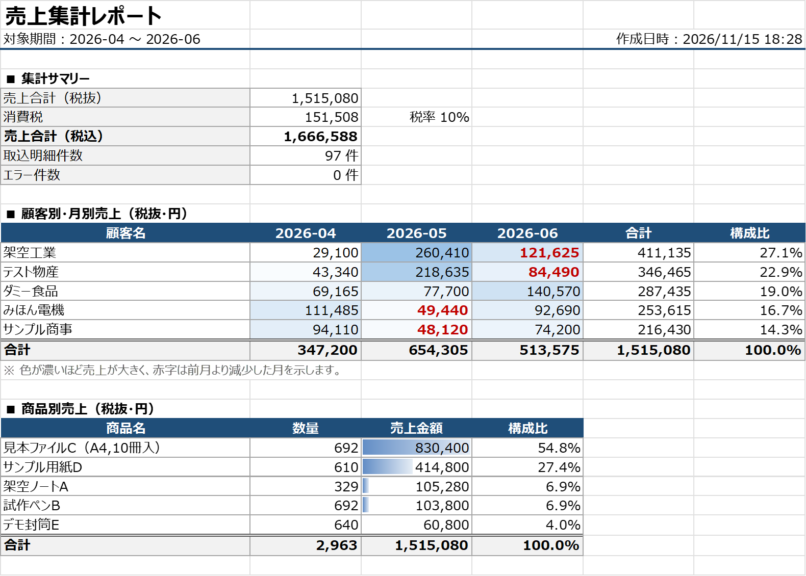
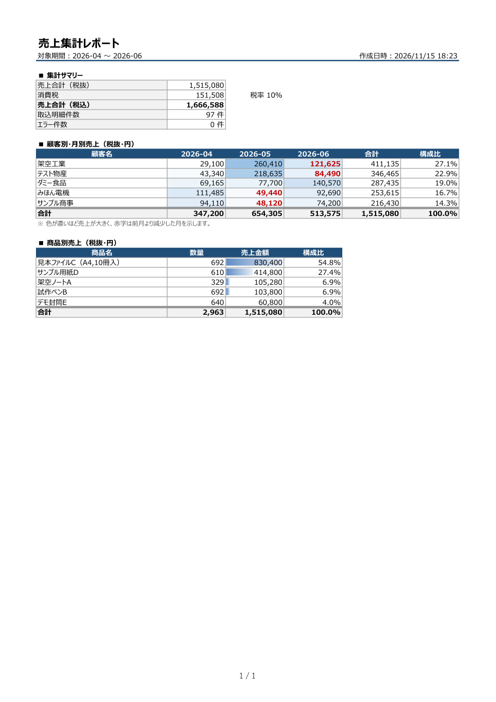
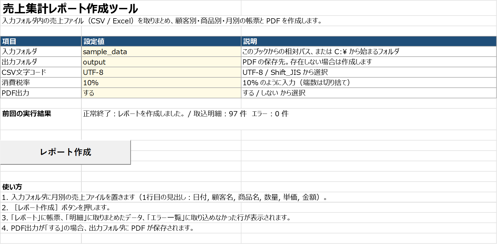
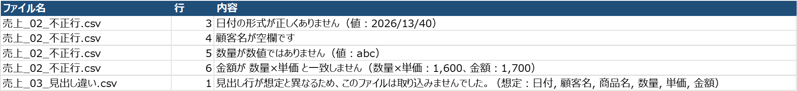
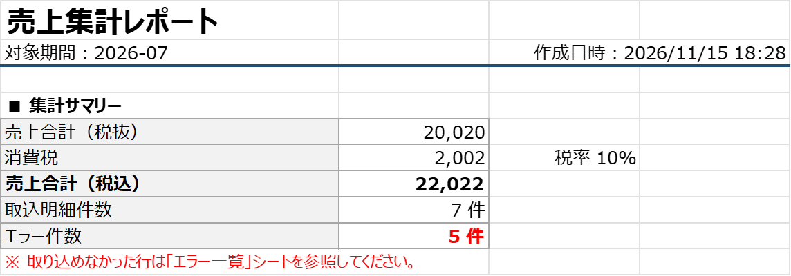
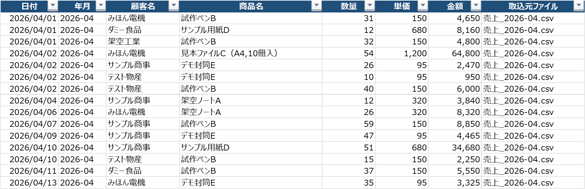
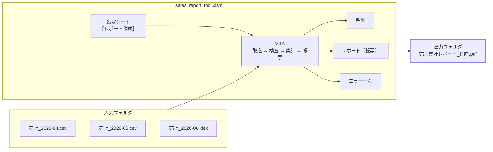

# 売上集計レポート作成ツール（Excel VBA）

フォルダに置いた月別の売上ファイル（CSV・Excel）をボタン1つで取りまとめ、顧客別・商品別・月別の集計帳票と PDF を作成する Excel ツールです。

> 本リポジトリはポートフォリオ（閲覧用）です。無断での再利用・再配布はご遠慮ください。
> 掲載しているデータ・会社名・商品名はすべて架空のものです。

## 概要

毎月、複数の売上ファイルを開いてコピーし、集計表を作って PDF にする作業を自動化します。

- **手作業のコピー＆貼り付けが不要**になり、貼り忘れ・二重貼りによる集計ミスを防ぎます
- 日付の書式違いや数字の入力ミスがある行は**処理を止めずに一覧表示**し、どのファイルの何行目を直せばよいかが分かります
- 集計結果は**そのまま提出できる帳票**（合計・消費税・税込合計つき）と PDF で出力します

## できること

| 機能 | 内容 |
|---|---|
| 複数ファイルの一括取込 | フォルダ内の CSV（UTF-8 / Shift_JIS）と Excel（.xlsx / .xls）をまとめて読み込みます |
| 入力チェック | 日付・顧客名・商品名・数量・単価・金額を検査し、「金額＝数量×単価」の食い違いも見つけます |
| エラー一覧 | 取り込めなかった行を、ファイル名・行番号・理由つきで一覧にします |
| 集計 | 顧客別・月別、商品別に売上を集計し、売上の多い順に並べます |
| 帳票 | 表題・対象期間・税抜合計・消費税・税込合計・構成比を備えた帳票を作成します |
| 見やすさの工夫 | 売上の大きいセルほど濃い色、前月より減った月は赤字、商品別の売上はバーで表示します |
| PDF 出力 | 帳票を A4 の PDF にして、作成日時入りのファイル名で保存します |
| 設定シート | 入力フォルダ・出力フォルダ・文字コード・消費税率・PDF 出力の有無を変更できます |

## 画面・出力例

以下の画像は、サンプルデータでツールを実行した結果です。Excel の画面はセル範囲を Excel の機能（範囲を画像としてコピー）で書き出したもの、PDF は実際に出力したファイルを画像にしたものです。

### 帳票（レポートシート）



### 出力した PDF（1ページ目）



### 設定シートと［レポート作成］ボタン



### 取り込めなかった行の一覧（エラー一覧シート）

不正な行を含むテスト用データで実行した例です。帳票のサマリーにもエラー件数が赤字で表示されます。





### 取りまとめた明細（明細シート・先頭部分）



## 構成



| モジュール | 役割 |
|---|---|
| [modMain](src/modMain.bas) | ボタンから呼ばれる入口。処理の順番・後始末・結果表示 |
| [modConfig](src/modConfig.bas) | 設定シートの読み込みと検証 |
| [modImport](src/modImport.bas) | CSV / Excel の読み込みと行ごとの入力チェック |
| [modAggregate](src/modAggregate.bas) | 顧客別・月別・商品別の集計 |
| [modReport](src/modReport.bas) | 明細シートと帳票の書き出し・書式 |
| [modExport](src/modExport.bas) | 印刷設定と PDF 出力 |
| [modUtil](src/modUtil.bas) | 定数・メッセージ表示・エラー一覧への記録 |
| [clsSalesRow](src/clsSalesRow.cls) | 明細1行を表すクラス |

## 使い方

1. `sales_report_tool.xlsm` と `sample_data` フォルダを同じ場所に置きます。
2. ブックを開き、［コンテンツの有効化］を押してマクロを有効にします。
3. 「設定」シートの［レポート作成］ボタンを押します。
4. 「レポート」シートに帳票が作成され、`output` フォルダに PDF が保存されます。

自社のデータで使う場合は、「設定」シートの「入力フォルダ」に売上ファイルのあるフォルダを入力します。売上ファイルの1行目（見出し）は `日付, 顧客名, 商品名, 数量, 単価, 金額` にそろえてください。
詳しくは [導入・運用手順書](docs/05_導入・運用手順.md) をご覧ください。

## 工夫した点

### エラー処理

- **誤りのある行は止めずに除外し、一覧にする。** 1件ずつ直しては再実行する往復をなくすためです。除外の見落としを防ぐため、完了メッセージ・設定シート・帳票の3か所にエラー件数を表示します（[ADR-0002](docs/adr/0002-skip-invalid-rows.md)）。
- **想定できるエラーは原因と対処を日本語で表示する。** 「入力フォルダが見つかりません」「同じ名前の PDF を開いていないか確認してください」のように、次に何をすればよいかが分かる文言にしています。
- **途中で失敗しても Excel の状態を元に戻す。** 処理中は画面更新と自動計算を止めて高速化していますが、エラー時も必ず元の設定に戻し、Excel が固まったように見える状態を残しません。
- **帳票は集計が成功してから書き換える。** 途中で失敗したときに、前回作成した帳票を壊さないためです。

### 設計

- **CSV は文字コードを指定して読み込む。** Excel で CSV を直接開くと文字化けや「2026-04 が日付になる」といった自動変換が起きるため、文字コードを明示して読み込み、値は検査で明示的に変換しています（[ADR-0001](docs/adr/0001-csv-read-with-adodb-stream.md)）。
- **設定はセル番地ではなく名前で参照する。** 設定シートの行を入れ替えても、コードの修正が要りません。
- **合計と消費税は帳票に数式で残す。** 受け取った人が帳票の上で検算できます。税率は帳票内に値で残すため、後で設定を変えても作成済みの帳票の数字は変わりません。
- **読み書きは配列でまとめて行う。** 12,000 行の明細でもマクロの処理時間は 1 秒未満でした（テスト環境での実測。TC-008）。
- **VBA のソースをテキストで管理し、ブックはスクリプトで組み立てる。** ソースとブックの食い違いを防ぎ、変更点を差分で確認できるようにしています（[ADR-0003](docs/adr/0003-source-as-text-build-workbook.md)）。

## 設計書とテスト

| 文書 | 内容 |
|---|---|
| [01 要件定義](docs/01_要件定義.md) | 背景・目的、機能要件 REQ-001〜009、非機能要件 REQ-101〜104、対象外 |
| [02 基本設計](docs/02_基本設計.md) | 全体構成、機能一覧 FN-001〜008、入出力、帳票レイアウト、データ項目 |
| [03 詳細設計](docs/03_詳細設計.md) | 機能ごとの処理フロー、例外・エラー処理表 ERR-001〜、ログ方針 |
| [04 テスト仕様書](docs/04_テスト仕様書.md) | テストケース TC-001〜010 と実施結果 |
| [05 導入・運用手順](docs/05_導入・運用手順.md) | 導入、毎月の運用、困ったとき、保守 |
| [ADR](docs/adr/) | 主要な設計判断の記録（3件） |
| [CHANGELOG](CHANGELOG.md) | 変更履歴 |

要件から機能・テストまでのつながり（抜粋）：

| 要件 | 機能 | テストケース |
|---|---|---|
| REQ-001 複数ファイルの一括取込 | FN-002 | TC-001, TC-006, TC-008 |
| REQ-002 入力チェックとエラー一覧 | FN-003 | TC-002, TC-007 |
| REQ-004 / 005 顧客別・月別・商品別の集計 | FN-005 | TC-001, TC-002, TC-006, TC-008 |
| REQ-006 帳票 | FN-006 | TC-001, TC-002 |
| REQ-007 PDF 出力 | FN-007 | TC-009, TC-010 |
| REQ-102 エラー処理 | FN-001, FN-008 | TC-003, TC-004, TC-005, TC-007, TC-010 |

**テストは実機の Excel で実行しています。** `tests/run_tests.py` が配布用ブックを実際に動かし、帳票に出た数値を、Python で別に計算した期待値と突き合わせます（10ケース・71項目、すべて合格）。条件付き書式の色は、帳票を画像にして目視で確認しました。

```text
合計 71 件中 PASS 71 / FAIL 0
```

## 動作環境

| 項目 | 内容 |
|---|---|
| 動作確認 | Windows 11 + Microsoft 365 版 Excel（16.0） |
| 想定 | Windows 版 Excel 2016 以降（Mac 版・Excel Online は対象外） |
| 追加のインストール | 不要（Windows 標準の部品のみを使用） |
| ビルド・テスト（開発者向け） | WSL2 上の Python 3 から Windows の Excel を操作（openpyxl が必要） |

## リポジトリの構成

```text
sales_report_tool.xlsm   配布用ブック（サンプルデータでの出力例入り）
src/                     VBA ソース（.bas / .cls、UTF-8）
build/                   ブックの組み立て・サンプルデータ作成・画像書き出しのスクリプト
sample_data/             架空の売上ファイル（CSV 2件・Excel 1件）
tests/                   自動テスト・期待値の計算・異常系のテストデータ
docs/                    設計書・ADR・画像
```
