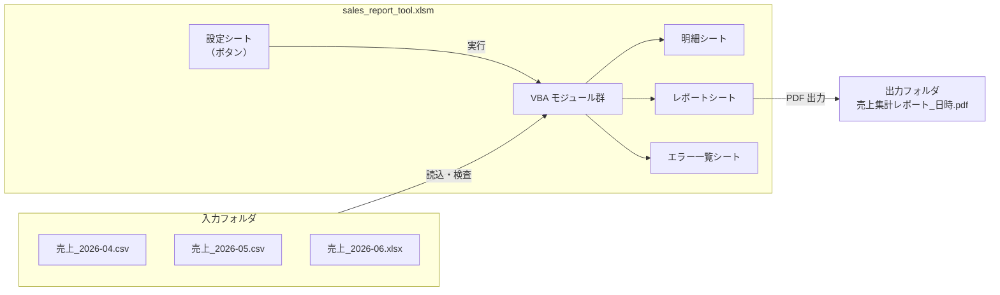

# 売上集計レポート作成ツール 基本設計書

## 文書情報

| 項目 | 内容 |
|---|---|
| 文書ID | BD-001 |
| システム名 | 売上集計レポート作成ツール |
| 版 | 1.0 |
| 作成日 | 2026-11-15 |
| 作成者 | takato-y |
| 状態 | 承認済 |

## 改版履歴

| 版 | 日付 | 変更内容 | 変更者 |
|---|---|---|---|
| 1.0 | 2026-11-15 | 新規作成 | takato-y |

## 1. 全体構成



### モジュール構成

| モジュール | 役割 |
|---|---|
| modMain | ボタンから呼ばれる入口。処理の順番・後始末・結果表示 |
| modConfig | 設定シートの読み込みと検証、相対パスの解決 |
| modImport | フォルダ内のファイル一覧、CSV / Excel の読み込み、行ごとの検査 |
| modAggregate | 顧客別・月別・商品別の集計、並べ替え |
| modReport | 明細シート・レポートシートの書き出しと書式 |
| modExport | 印刷設定と PDF 出力 |
| modUtil | 定数、メッセージ表示、エラー一覧への記録 |
| clsSalesRow | 明細1行を表すクラス |

## 2. 機能一覧

| 機能ID | 機能名 | 概要 | 関連要件 |
|---|---|---|---|
| FN-001 | 設定読込・検証 | 設定シートの値を読み、入力値と入力フォルダの存在を検査する | REQ-008, REQ-102, REQ-103 |
| FN-002 | 入力ファイル取込 | フォルダ内の CSV / Excel を名前順に読み込む | REQ-001, REQ-101 |
| FN-003 | 入力チェック・エラー一覧 | 見出しと各行を検査し、不正な行をエラー一覧に記録して除外する | REQ-002 |
| FN-004 | 統合明細出力 | 正しい明細を1シートにまとめて書き出す | REQ-003, REQ-101 |
| FN-005 | 集計 | 顧客別・月別・商品別に金額と数量を集計する | REQ-004, REQ-005 |
| FN-006 | 帳票作成 | 集計結果を帳票レイアウトで書き出し、合計・消費税・条件付き書式を付ける | REQ-006 |
| FN-007 | PDF 出力 | 印刷設定を整え、帳票を PDF で保存する | REQ-007 |
| FN-008 | 実行制御 | ボタン実行、結果表示、エラー時の後始末、テスト用の無表示実行 | REQ-009, REQ-102, REQ-104 |

## 3. 入出力

### 3.1 入力ファイル

| 項目 | 内容 |
|---|---|
| 形式 | CSV（UTF-8 または Shift_JIS）、Excel（.xlsx / .xls の先頭シート） |
| 見出し行 | 1行目に「日付, 顧客名, 商品名, 数量, 単価, 金額」 |
| 対象外のファイル | 上記以外の拡張子、名前が `~$` で始まる Excel の一時ファイル |
| 読む順番 | ファイル名の昇順（実行のたびに結果が変わらないようにする） |

### 3.2 設定シート

| 名前（コードから参照） | 項目 | 既定値 | 入力規則 |
|---|---|---|---|
| cfg_InputFolder | 入力フォルダ | sample_data | 空欄は既定値。相対パスはブックの場所から解決 |
| cfg_OutputFolder | 出力フォルダ | output | 同上。無ければ作成 |
| cfg_Charset | CSV 文字コード | UTF-8 | UTF-8 / Shift_JIS |
| cfg_TaxRate | 消費税率 | 10% | 0 以上 1 未満 |
| cfg_ExportPdf | PDF 出力 | する | する / しない |
| cfg_Status | 前回の実行結果 | （空欄） | 処理が書き込む |

### 3.3 出力

| シート / ファイル | 内容 |
|---|---|
| 明細 | 日付・年月・顧客名・商品名・数量・単価・金額・取込元ファイル。オートフィルター付き |
| レポート | 帳票（3.4 参照） |
| エラー一覧 | ファイル名・行番号・内容 |
| PDF | 出力フォルダに `売上集計レポート_yyyymmdd_hhnnss.pdf` |

### 3.4 帳票レイアウト

```text
  A                 B          C          D          E          F
1 売上集計レポート
2 対象期間：2026-04 ～ 2026-06                      作成日時：yyyy/mm/dd hh:nn
4 ■ 集計サマリー
5 売上合計（税抜）   ##,###
6 消費税（10%）      ##,###     ← 税抜合計 × 税率（切り捨て）を数式で表示
7 売上合計（税込）   ##,###
8 取込明細件数       ## 件
9 エラー件数         ## 件
11 ■ 顧客別・月別売上（税抜・円）   ※ 赤字は前月より減少した月
12 顧客名            2026-04    2026-05    2026-06    合計       構成比
13 （売上の多い順）  ...        ...        ...        =SUM(..)   ..%
   合計              =SUM(..)   ...
   ■ 商品別売上（税抜・円）
   商品名            数量       売上金額   構成比
   （売上の多い順）  ...
   合計
```

| 書式 | 対象 | 目的 |
|---|---|---|
| カラースケール（白→青） | 顧客別・月別の金額 | 売上の大きい顧客・月をひと目で分かるようにする |
| 赤字 | 前月より減少した月の金額 | 落ち込みに気づけるようにする |
| データバー | 商品別の売上金額 | 商品間の差を比べやすくする |

## 4. データ項目

| 項目 | 型 | 検査 | 備考 |
|---|---|---|---|
| 日付 | 日付 | 日付として解釈できること | `2026/04/01`・`2026-04-01`・Excel の日付値 |
| 年月 | 文字列 | （日付から作成） | `yyyy-mm`。月別集計の単位 |
| 顧客名 | 文字列 | 空欄不可 | 前後の空白は除く |
| 商品名 | 文字列 | 空欄不可 | 同上 |
| 数量 | 数値 | 空欄不可・数値 | |
| 単価 | 数値 | 空欄不可・数値 | |
| 金額 | 数値 | 空欄不可・数値・数量×単価と一致 | 差が 0.5 を超えたら不一致とする |
| 取込元ファイル | 文字列 | （処理が付与） | エラー調査と検算のため |

## 5. 関連する設計判断

- [ADR-0001 CSV の読み込みに ADODB.Stream を使う](adr/0001-csv-read-with-adodb-stream.md)
- [ADR-0002 不正な行は処理を止めずにエラー一覧へ出す](adr/0002-skip-invalid-rows.md)
- [ADR-0003 VBA ソースをテキストで管理し、ブックはスクリプトで組み立てる](adr/0003-source-as-text-build-workbook.md)
