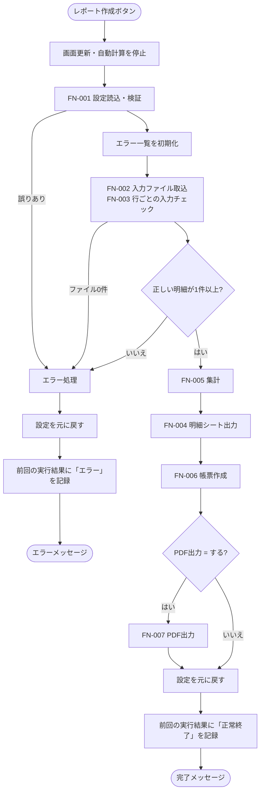
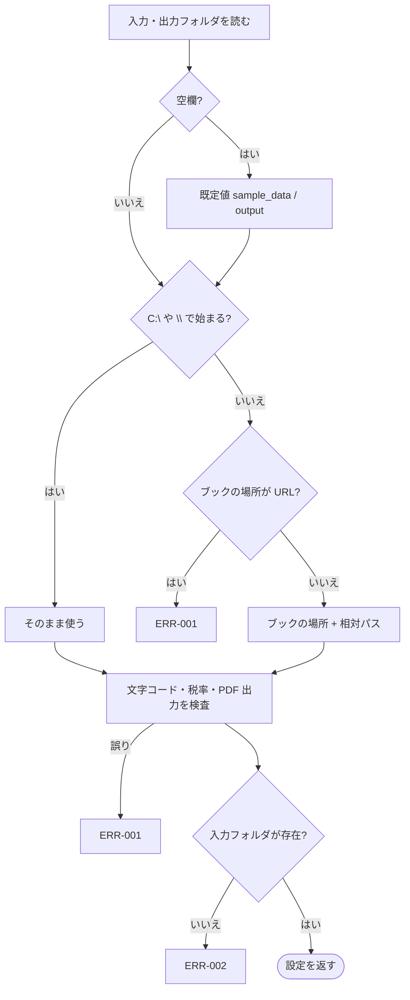
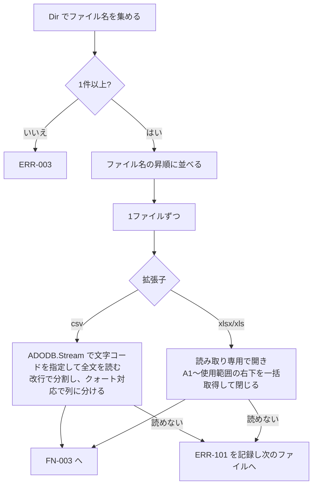

# 売上集計レポート作成ツール 詳細設計書

## 文書情報

| 項目 | 内容 |
|---|---|
| 文書ID | DD-001 |
| システム名 | 売上集計レポート作成ツール |
| 版 | 1.1 |
| 作成日 | 2026-11-15 |
| 作成者 | takato-y |
| 状態 | 承認済 |

## 改版履歴

| 版 | 日付 | 変更内容 | 変更者 |
|---|---|---|---|
| 1.0 | 2026-11-15 | 新規作成 | takato-y |
| 1.1 | 2026-11-16 | エラー一覧の消去の時点、空のファイルの扱い（ERR-101）、中止時の記録内容を実装に合わせて修正 | takato-y |

## 1. 処理全体の流れ

### FN-008 実行制御

モジュール：modMain（`RunReport` / `RunReportForTest` / `RunReportCore`）

- 帳票（レポートシート・明細シート）は集計が成功してから書き換える。途中で失敗した場合は前回の帳票が残る
- エラー一覧は設定の読み込み（LoadConfig）の直後に消去し、今回の実行で見つかった内容だけを表示する。設定の読み込みの中で中止した場合（ERR-001 設定値の誤り、ERR-002 入力フォルダがない）は消去の前に止まるため、前回の内容が残る

## 2. 機能ごとの処理

FN-008 以外の機能を、処理の順に示す。

### FN-001 設定読込・検証

| 項目 | 内容 |
|---|---|
| モジュール | modConfig（`LoadConfig` / `ResolvePath` / `FolderExists`） |
| 入力 | 設定シートの名前付きセル（cfg_InputFolder ほか） |
| 出力 | ReportConfig 型（入力フォルダ・出力フォルダ・文字コード・税率・PDF 出力の有無） |

### FN-002 入力ファイル取込

| 項目 | 内容 |
|---|---|
| モジュール | modImport（`ImportFolder` / `ListInputFiles` / `ReadCsv` / `ReadExcel`） |
| 入力 | 入力フォルダ内の .csv / .xlsx / .xls（`~$` で始まる名前は除く） |
| 出力 | ファイルごとの2次元配列（1行目が見出し） |

### FN-003 入力チェック・エラー一覧

| 検査 | 単位 | 不合格時の扱い | エラーID |
|---|---|---|---|
| 見出し行が6列そろっている | ファイル | ファイルを丸ごと除外 | ERR-102 |
| 見出しが「日付, 顧客名, 商品名, 数量, 単価, 金額」と一致 | ファイル | ファイルを丸ごと除外 | ERR-102 |
| 空行 | 行 | 何もせず読み飛ばす | － |
| 日付として解釈できる | 行 | 行を除外 | ERR-103 |
| 顧客名・商品名が空欄でない | 行 | 行を除外 | ERR-104 |
| 数量・単価・金額が空欄でなく数値 | 行 | 行を除外 | ERR-105 |
| 金額と数量×単価の差が 0.5 以下 | 行 | 行を除外 | ERR-106 |

検査は上の順に行い、最初に見つかった理由を1つだけ記録する。

### FN-004 統合明細出力

全明細を `行数 × 8列` の配列に詰め、`Range.Value` への1回の代入で書き込む。
年月の列は書き込む前に文字列書式にする（`2026-04` が日付に自動変換されるのを防ぐため）。

### FN-005 集計

`Scripting.Dictionary` を使い、明細を1回走査して次を同時に作る。

| キー | 値 |
|---|---|
| 年月 | （存在の印） |
| 顧客 | 金額合計 |
| 顧客 + タブ + 年月 | 金額 |
| 商品 | 数量合計 / 金額合計 |

- 文字列の比較は完全一致（全角半角・大文字小文字を同一視しない）
- 並び順：顧客・商品は金額の多い順、同額は名前順。年月は昇順

### FN-006 帳票作成

1. 月の数から列位置（合計列・構成比列）と各表の行位置を先に計算する
2. 表題・対象期間・作成日時を書く
3. 集計サマリー：税抜合計は顧客別の表の合計セルを参照、消費税は `ROUNDDOWN(税抜合計 × 税率, 0)`。税率は帳票内のセルに値で残す
4. 顧客別・月別の表：金額は配列で一括書き込み、合計・構成比は R1C1 形式の数式で一括設定
5. 商品別の表：同上
6. 条件付き書式：金額にカラースケール、前月より減った月に赤字（R1C1 形式の数式 `=RC<RC[-1]`）、商品別の金額にデータバー

### FN-007 PDF 出力

| 手順 | 内容 |
|---|---|
| 1 | 出力フォルダが無ければ作成（1階層のみ） |
| 2 | 印刷設定：印刷範囲＝使用範囲、A4、横は1ページに縮小、9列以上なら横向き、ページ番号をフッターに |
| 3 | `ExportAsFixedFormat` で `売上集計レポート_yyyymmdd_hhnnss.pdf` を保存 |
| 4 | ファイルの存在を確認 |

印刷設定は `Application.PrintCommunication = False` の間にまとめて行い、プリンターとの通信を1回にする。

## 3. 例外・エラー処理

ERR-001〜005 はコード上の定数 `ERR_CONFIG` / `ERR_FOLDER` / `ERR_NO_FILES` / `ERR_NO_VALID_ROWS` / `ERR_PDF`（modUtil）に対応する。ERR-101〜106 はエラー一覧シートに記録する行・ファイル単位の理由。

| ID | 発生条件 | 表示するメッセージ（要旨） | 処理 |
|---|---|---|---|
| ERR-001 | 設定値の誤り（文字コード・税率・PDF 出力）、未保存のブックやクラウド上のブックで相対パス | 「◯◯」は△△で入力してください | 中止 |
| ERR-002 | 入力フォルダが存在しない | 入力フォルダが見つかりません＋パス | 中止 |
| ERR-003 | 入力フォルダに対象ファイルが無い | 入力フォルダに CSV / Excel ファイルがありません | 中止 |
| ERR-004 | 正しい明細が1件も無い | 取り込める明細が1件もありませんでした | 中止（エラー一覧は残す） |
| ERR-005 | 出力フォルダを作れない、印刷設定の失敗、PDF の保存失敗 | 出力フォルダを作成できませんでした／PDF を保存できませんでした 等 | 中止（帳票は作成済み） |
| ERR-101 | ファイルを開けない・読めない・空のファイル（「ファイルが空です。」と記録） | ファイルを読み込めませんでした | そのファイルを除外して続行 |
| ERR-102 | 見出し行の不一致・列不足 | 見出し行が想定と異なるため、このファイルは取り込みませんでした | そのファイルを除外して続行 |
| ERR-103 | 日付の形式誤り | 日付の形式が正しくありません（値：…） | その行を除外して続行 |
| ERR-104 | 顧客名・商品名の空欄 | 顧客名が空欄です 等 | その行を除外して続行 |
| ERR-105 | 数量・単価・金額の空欄・非数値 | 数量が数値ではありません（値：…） 等 | その行を除外して続行 |
| ERR-106 | 金額 ≠ 数量×単価 | 金額が 数量×単価 と一致しません（…） | その行を除外して続行 |
| ERR-900 | 上記以外の実行時エラー | 予期しないエラーが発生したため、処理を中止しました（エラー番号・内容）＋確認ポイント | 中止 |

- ERR-001〜005 は `vbObjectError + 1000` 以降の独自番号で `Err.Raise` し、入口（RunReportCore）の1か所でまとめて受ける
- 中止した場合も、画面更新と自動計算の設定は必ず元に戻す
- 「前回の実行結果」には、中止した場合「エラー」と元のエラー内容（`Err.Description`）を記録する。ERR-900 のエラー番号と確認ポイントはメッセージにだけ表示する
- テスト実行時（`gSilent = True`）はメッセージボックスを出さず、メッセージの文言はイミディエイトウィンドウに出力する

## 4. ログ方針

| 出力先 | 内容 | 目的 |
|---|---|---|
| 設定シート「前回の実行結果」 | `正常終了：…件数…` または `エラー：…理由…` | 最後に何が起きたかを、メッセージを閉じた後でも確認できるようにする |
| エラー一覧シート | ファイル名・行番号（ファイル全体は「-」）・理由 | 元データのどこを直せばよいかを示す |
| 帳票のサマリー | 取込明細件数・エラー件数 | PDF だけを受け取った人にも、除外があったことが伝わるようにする |

外部のログファイルは作らない（利用者のフォルダに不要なファイルを増やさないため）。

## 5. 関連 ID

| 機能ID | 関連要件 | テストケース |
|---|---|---|
| FN-001 | REQ-008, REQ-102, REQ-103 | TC-003, TC-005 |
| FN-002 | REQ-001, REQ-101 | TC-001, TC-002, TC-004, TC-006, TC-008 |
| FN-003 | REQ-002 | TC-002, TC-007 |
| FN-004 | REQ-003, REQ-101 | TC-001, TC-008 |
| FN-005 | REQ-004, REQ-005 | TC-001, TC-002, TC-006, TC-008 |
| FN-006 | REQ-006 | TC-001, TC-002 |
| FN-007 | REQ-007 | TC-009, TC-010 |
| FN-008 | REQ-009, REQ-102, REQ-104 | TC-001〜TC-010 |
