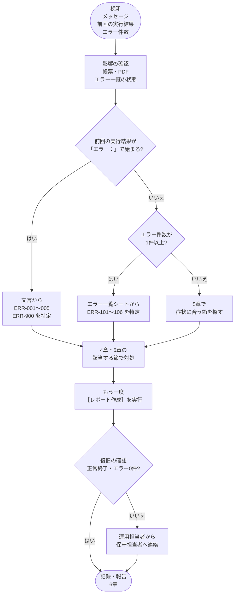

# 売上集計レポート作成ツール 障害対応手順書

## 文書情報

| 項目 | 内容 |
|---|---|
| 文書名 | 障害対応手順書 |
| 文書ID | OP-INC-001 |
| システム名 | 売上集計レポート作成ツール |
| 版 | 1.0 |
| 作成日 | 2026-11-16 |
| 作成者 | takato-y |
| 状態 | 承認済 |

## 改版履歴

| 版 | 日付 | 変更内容 | 変更者 |
|---|---|---|---|
| 1.0 | 2026-11-16 | 新規作成 | takato-y |

## 1. 目的と対象

### 1.1 目的

［レポート作成］の実行が失敗したとき、または帳票の内容がおかしいときに、原因を切り分けて元の状態に戻すまでの手順を定める。詳細設計書（DD-001）3章のエラーID ごとに、確認することと対処を示す。

### 1.2 使う人と使う場面

| 使う人 | 使う場面 |
|---|---|
| 利用者 | エラーメッセージが出たとき、エラー件数が 0 件にならないとき。4章の該当する節の「対処」まで行う |
| 運用担当者 | 利用者の対処で直らないとき、設定シートや入力フォルダの見直しが必要なとき。3章の順に切り分ける |
| 保守担当者 | ERR-900（予期しないエラー）、ブックの破損、VBA の修正が必要なとき |

### 1.3 対象範囲

| 対象 | 対象外 |
|---|---|
| 配布用ブック `sales_report_tool.xlsm` の［レポート作成］の実行（FN-001〜FN-008） | 売上ファイルを出力する元のシステムの障害 |
| 入力フォルダ・出力フォルダ・設定シートに起因する障害 | Excel・Windows そのものの不具合の修理 |
| 帳票・PDF の内容の誤り | 開発用のビルド・テストのスクリプト（`build/`・`tests/`）の不具合 |

## 2. 障害時の基本の流れ



## 3. 切り分けの順番

本ツールは外部のログファイルを作らない（DD-001 4章）。手がかりは次の4か所だけであるため、上から順に確かめる。

| 順 | 確認する場所 | 見ること | 次に進む先 |
|---|---|---|---|
| 1 | 表示されたメッセージ（題名「売上集計レポート」） | 文言。閉じてしまった場合は手順 2 で確かめる | 4章の該当する節 |
| 2 | 設定シート「前回の実行結果」（名前 `cfg_Status`） | 先頭が `正常終了：` か `エラー：` か。`実行中...` のまま残っていれば、処理が最後まで進まずに止まっている | `エラー：` → 文言で ERR-001〜005 を照合し、どれにも当たらなければ ERR-900。`実行中...` → 5.2 |
| 3 | エラー一覧シート | ファイル名・行（ファイル全体のときは `-`）・内容 | 内容の文言で ERR-101〜106 を照合 |
| 4 | レポートシートの集計サマリー | 取込明細件数・エラー件数・対象期間・作成日時 | 件数や期間が想定と違う → 5.3 |

### 3.1 前回の実行結果とメッセージの違い

- ERR-001〜005 は、メッセージと「前回の実行結果」の文言が同じ（改行は空白に置き換わる）。
- ERR-900 は、メッセージに「予期しないエラーが発生したため、処理を中止しました。（エラー番号 n：内容）」と表示されるが、「前回の実行結果」には `エラー：` に続けて Excel・VBA のエラー内容だけが記録される。番号はメッセージにしか出ないため、メッセージを閉じる前に控える。

### 3.2 エラー一覧が今回の実行のものか

エラー一覧は、設定の読み込み（FN-001）が成功した後に消去される。ERR-001・ERR-002 で止まった場合、エラー一覧には**前回の実行の内容が残っている**。この2件の調査ではエラー一覧を見ない。

## 4. エラー別の対応手順

各節の文言は、コードが表示する文言をそのまま示す。「…」は実行時に値やパスが入る部分を表す。

### `ERR-001` 設定値の誤り

| 項目 | 内容 |
|---|---|
| 事象 | 次のいずれかのメッセージが出て中止する。「「CSV文字コード」は UTF-8 または Shift_JIS を選んでください。（現在の値：…）」「「消費税率」は 10% のように数値で入力してください。」「「消費税率」は 0% 以上 100% 未満で入力してください。」「「PDF出力」は「する」または「しない」を選んでください。」「ブックが保存されていないため、相対パスを解決できません。先にブックを保存してください。」「ブックがクラウド上の場所にあるため、相対パスを使えません。設定シートに C:\ から始まるフォルダを入力してください。」 |
| 影響 | 何も読み込まず、帳票・明細・PDF は変わらない（前回の内容が残る）。入力ファイルは変更しない。エラー一覧は前回の内容のまま（3.2） |
| 想定原因 | 設定シートの値の誤り。新しいブックとして未保存のまま実行した。OneDrive などの同期フォルダにブックがあり、ブックの場所が URL になっている |
| 確認すること | 設定シートの「CSV文字コード」「消費税率」「PDF出力」の値。入力・出力フォルダが相対パス（`C:\` や `\\` で始まらない）かどうか。ブックの保存場所 |
| 対処 | メッセージが示す項目を直す。相対パスの2件は、ブックを保存するか、入力・出力フォルダを `C:\` から始まる形で入力する |
| 復旧の確認 | 再実行して「前回の実行結果」が `正常終了：` で始まる |
| 再実行してよいか | よい。中止時点では何も書き換えていないため、二重の取込や二重の出力は起きない |
| 関連 | FN-001、TC-005 |

検査は「入力フォルダ・出力フォルダのパス → CSV文字コード → 消費税率 → PDF出力」の順に行い、最初に見つかった1件だけを表示する。複数の誤りがある場合は、直して再実行するたびに次の誤りが表示される。

### `ERR-002` 入力フォルダが存在しない

| 項目 | 内容 |
|---|---|
| 事象 | 「入力フォルダが見つかりません。」に続けて、探したフォルダのパスと「設定シートの「入力フォルダ」を確認してください。」が表示され、中止する |
| 影響 | 何も読み込まず、帳票・明細・PDF は変わらない。エラー一覧は前回の内容のまま（3.2） |
| 想定原因 | 「入力フォルダ」の入力誤り。フォルダの移動・名前の変更。相対パスで入力しており、ブックを別の場所へ移した。ネットワーク上のフォルダに接続できない |
| 確認すること | メッセージに表示されたパスを、エクスプローラーのアドレス欄に貼り付けて開けるか |
| 対処 | 「入力フォルダ」を正しいパスに直す。`C:\` から始まる形で入力すると、ブックの場所に左右されない |
| 復旧の確認 | 再実行して `正常終了：` が記録される |
| 再実行してよいか | よい。副作用なし |
| 関連 | FN-001、TC-003 |

### `ERR-003` 入力フォルダに対象ファイルが無い

| 項目 | 内容 |
|---|---|
| 事象 | 「入力フォルダに CSV / Excel ファイルがありません。」に続けて入力フォルダのパスが表示され、中止する |
| 影響 | 帳票・明細・PDF は変わらない。エラー一覧は空になる |
| 想定原因 | フォルダが空。拡張子が対象外（.csv / .xlsx / .xls 以外）。名前が `~$` で始まる Excel の一時ファイルしかない |
| 確認すること | 入力フォルダの中身。エクスプローラーで拡張子を表示し、`.csv.txt` のような二重の拡張子になっていないか |
| 対処 | 対象の拡張子の売上ファイルを置く。別のフォルダを見ている場合は「入力フォルダ」を直す |
| 復旧の確認 | 再実行して `正常終了：` が記録され、取込明細件数が 0 件より多い |
| 再実行してよいか | よい。副作用なし |
| 関連 | FN-002、TC-004 |

### `ERR-004` 正しい明細が1件も無い

| 項目 | 内容 |
|---|---|
| 事象 | 「取り込める明細が1件もありませんでした。「エラー一覧」シートで理由を確認してください。」が表示され、中止する |
| 影響 | 帳票・明細・PDF は変わらない（前回の内容が残る）。エラー一覧には今回の実行で見つかった理由が残る |
| 想定原因 | すべてのファイルが ERR-101・ERR-102 で除外された、またはすべての行が ERR-103〜106 で除外された。CSV の文字コードの設定違いで見出しが文字化けし、全ファイルが見出し違いになった |
| 確認すること | エラー一覧シートの「内容」。見出しの文字が化けていれば「CSV文字コード」の設定違い |
| 対処 | エラー一覧の理由ごとに、4章の ERR-101〜106 の節に従って直す。文字化けのときは「CSV文字コード」を UTF-8 と Shift_JIS で切り替える |
| 復旧の確認 | 再実行して `正常終了：` が記録され、取込明細件数が想定の件数になる |
| 再実行してよいか | よい。副作用なし |
| 関連 | FN-003、FN-008、TC-007 |

### `ERR-005` 出力フォルダの作成・PDF の保存の失敗

| 項目 | 内容 |
|---|---|
| 事象 | 次のいずれかが表示され、中止する。「出力フォルダを作成できませんでした。上の階層のフォルダが存在するか確認してください。」（＋パス）「印刷設定を反映できませんでした。Windows の「既定のプリンター」が設定されているか確認してください。（…）」「PDF を保存できませんでした。出力フォルダに書き込めるか、同じ名前の PDF を開いていないか確認してください。（…）」「PDF の作成を確認できませんでした。」（＋パス） |
| 影響 | **帳票・明細・エラー一覧は今回の内容で作成済み**。PDF だけが作られていない。入力ファイルは変更しない |
| 想定原因 | 出力フォルダの上の階層が無い（出力フォルダは1階層だけ作る）。既定のプリンターが無い。出力フォルダに書き込む権限が無い。同じ名前の PDF を開いている。保存先の空き容量が足りない |
| 確認すること | メッセージのパスの上の階層が存在するか。Windows の設定で既定のプリンターがあるか。出力フォルダにエクスプローラーで新しいファイルを作れるか |
| 対処 | 上の階層のフォルダを作るか、「出力フォルダ」を存在する場所に直す。既定のプリンターを設定する（「Microsoft Print to PDF」でも可）。開いている PDF を閉じる |
| 復旧の確認 | 再実行してメッセージの最後に「PDF：」とパスが表示され、そのファイルを開ける |
| 再実行してよいか | よい。PDF の名前に作成日時（秒まで）が入るため、再実行のたびに新しい PDF ができ、前回の PDF は上書きされない。送付には最も新しい日時の PDF を使う |
| 関連 | FN-007、TC-010 |

### `ERR-101` ファイルを開けない・読めない

| 項目 | 内容 |
|---|---|
| 事象 | 処理は完了するが、エラー件数が 1 件以上になる。エラー一覧の行が `-`、内容が「ファイルを読み込めませんでした。他のアプリで開いていないか確認してください。（…）」 |
| 影響 | そのファイルの明細がすべて集計から抜ける。帳票と PDF は残りのファイルだけで作られるため、**金額が少なく出る** |
| 想定原因 | 別のアプリで開いていてロックされている。同じ名前のブックを Excel で開いている。ファイルが壊れている。ネットワーク上のファイルが読めない |
| 確認すること | エラー一覧のファイル名のファイルを、エクスプローラーからダブルクリックして開けるか。括弧の中の Excel・VBA のエラー内容 |
| 対処 | 開いているアプリを閉じる。壊れている場合は元のシステムから出力し直す |
| 復旧の確認 | 再実行してエラー一覧からそのファイルの行が消え、取込明細件数が増える |
| 再実行してよいか | よい。再実行のたびに入力フォルダ全体を読み直して帳票を作り直すため、二重に集計されることはない |
| 関連 | FN-002（自動テストは未実施。テスト仕様書 5章） |

ファイルが 0 バイトなどで中身が無い場合は、エラー一覧に「ファイルが空です。」と記録され、そのファイルは集計から抜ける。対処は ERR-101 と同じく、元のシステムから出力し直す。

### `ERR-102` 見出し行の不一致・列不足

| 項目 | 内容 |
|---|---|
| 事象 | エラー一覧の行が `1`、内容が「見出し行が想定と異なるため、このファイルは取り込みませんでした。（想定：日付, 顧客名, 商品名, 数量, 単価, 金額）」または「列の数が足りません（6列必要）。このファイルは取り込みませんでした。」 |
| 影響 | そのファイルの明細がすべて集計から抜け、金額が少なく出る。全ファイルが該当すると ERR-004 で中止する |
| 想定原因 | 元のシステムの出力項目・列名の変更。見出しの前に表題の行がある。CSV の文字コードの設定違いによる文字化け |
| 確認すること | ファイルの1行目。見出しが文字化けしていないか |
| 対処 | 1行目を「日付, 顧客名, 商品名, 数量, 単価, 金額」にそろえる。文字化けのときは「CSV文字コード」を切り替える。元のシステムの列名が恒常的に変わった場合は保守担当者へ連絡する（`modImport` の `ExpectedHeader` の変更が必要） |
| 復旧の確認 | 再実行してエラー一覧からそのファイルの行が消える |
| 再実行してよいか | よい。副作用なし |
| 関連 | FN-003、TC-002、TC-007 |

### `ERR-103` 日付の形式誤り

| 項目 | 内容 |
|---|---|
| 事象 | エラー一覧の内容が「日付の形式が正しくありません（値：…）」 |
| 影響 | その行だけが集計から抜ける |
| 想定原因 | 日付の入力誤り（存在しない日付、文字の混入）。Excel のエラー値の場合は値が「(エラー値)」と表示される |
| 確認すること | エラー一覧のファイル名・行番号の行の「日付」列 |
| 対処 | 元のファイルの日付を直す |
| 復旧の確認 | 再実行してエラー件数が減る |
| 再実行してよいか | よい。副作用なし |
| 関連 | FN-003、TC-002 |

### `ERR-104` 顧客名・商品名の空欄

| 項目 | 内容 |
|---|---|
| 事象 | エラー一覧の内容が「顧客名が空欄です」または「商品名が空欄です」 |
| 影響 | その行だけが集計から抜ける |
| 想定原因 | 入力漏れ。空白だけが入っている |
| 確認すること | エラー一覧のファイル名・行番号の行 |
| 対処 | 元のファイルに顧客名・商品名を入れる |
| 復旧の確認 | 再実行してエラー件数が減る |
| 再実行してよいか | よい。副作用なし |
| 関連 | FN-003、TC-002 |

### `ERR-105` 数量・単価・金額の空欄・非数値

| 項目 | 内容 |
|---|---|
| 事象 | エラー一覧の内容が「数量が空欄です」「数量が数値ではありません（値：…）」（単価・金額も同じ形） |
| 影響 | その行だけが集計から抜ける |
| 想定原因 | 入力漏れ。単位や文字の混入（例：`10個`） |
| 確認すること | エラー一覧のファイル名・行番号の行の該当列 |
| 対処 | 元のファイルの値を数値に直す |
| 復旧の確認 | 再実行してエラー件数が減る |
| 再実行してよいか | よい。副作用なし |
| 関連 | FN-003、TC-002 |

### `ERR-106` 金額 ≠ 数量×単価

| 項目 | 内容 |
|---|---|
| 事象 | エラー一覧の内容が「金額が 数量×単価 と一致しません（数量×単価：…、金額：…）」 |
| 影響 | その行だけが集計から抜ける |
| 想定原因 | 金額・数量・単価の入力誤り。列のずれ。値引きなどを金額にだけ反映している |
| 確認すること | 括弧内の2つの値と、元のファイルの該当行 |
| 対処 | 元のファイルの値を直す。値引きを金額に含める運用が必要な場合は、要件の変更として保守担当者へ相談する（差が 0.5 を超えると不一致とする規則のため） |
| 復旧の確認 | 再実行してエラー件数が減る |
| 再実行してよいか | よい。副作用なし |
| 関連 | FN-003、TC-002 |

### `ERR-900` 予期しないエラー

| 項目 | 内容 |
|---|---|
| 事象 | 「予期しないエラーが発生したため、処理を中止しました。」「（エラー番号 n：内容）」「入力ファイルや出力先の PDF を開いたままにしていないか確認してください。」が表示され、中止する。「前回の実行結果」は `エラー：` に続けてエラー内容だけが記録される（3.1） |
| 影響 | どこで止まったかによって異なる。集計（FN-005）より前なら帳票・明細は前回のまま、帳票の作成中なら作りかけの帳票が残ることがある。入力ファイルは変更しない |
| 想定原因 | シート名（設定・レポート・明細・エラー一覧）や名前付きセル（`cfg_` で始まる名前）が変更・削除された。ブックの破損。上記以外の Excel・Windows の実行時エラー |
| 確認すること | メッセージのエラー番号と内容（メッセージを閉じる前に控える）。4つのシートと、基本設計書 3.2 の名前付きセル（`cfg_` で始まる6つ）が残っているか |
| 対処 | 入力ファイルと PDF を閉じて1回だけ再実行する。同じエラーが出る場合は、利用者はそれ以上操作せず、エラー番号・内容・発生時刻を運用担当者へ伝える。保守担当者は、バックアップのブック、または `src/` から組み立て直したブックに差し替える（導入・運用手順書 5.2） |
| 復旧の確認 | 差し替えたブックで再実行し、`正常終了：` が記録される。帳票の作成日時が今回の実行の日時になっている |
| 再実行してよいか | よい。帳票・明細は再実行のたびに作り直すため、作りかけの帳票も上書きされる。ただし、ブックの破損が疑われる場合は、上書き保存せずに閉じてから差し替える |
| 関連 | FN-008（自動テストは未実施。テスト仕様書 5章） |

## 5. エラーIDの付かない障害

### 5.1 ボタンを押しても何も起きない

- 原因：マクロが無効になっている。インターネットから入手したファイルがブロックされている。
- 対処：導入・運用手順書 1.2 の手順 2・3 を行う。

### 5.2 Excel が応答しない・強制終了した（前回の実行結果が `実行中...` のまま）

- 原因：処理が最後まで進まずに止まった。処理中に Excel を強制終了した、または［Esc］・［Ctrl］＋［Break］で中断して終了を選んだ。
- 影響：処理中は自動計算を手動に切り替えているため、後始末を通らずに止まった場合は、Excel の計算方法が手動のまま残ることがある。入力ファイルは変更しない。
- 対処：ブックを上書き保存せずに閉じて、開き直してから再実行する。計算方法が手動のままになっていれば、Excel の計算方法の設定を「自動」に戻す。

### 5.3 処理は正常終了したが、金額や件数が想定と違う

エラーにはならないため、集計サマリーの件数と対象期間を手がかりに確かめる。

| 確かめること | 原因の例 | 対処 |
|---|---|---|
| エラー件数が 0 件か | ERR-101〜106 で除外された行がある | 4章の該当する節 |
| 入力フォルダに同じ月のファイルが重複して置かれていないか（例：`売上_2026-04 - コピー.csv`） | 入力フォルダ内の対象ファイルをすべて集計するため、重複したファイルは二重に計上される | 不要なファイルを入力フォルダから移して再実行する |
| 明細シートの「取込元ファイル」列 | 想定外のファイルが混ざっている | 同上 |
| 同じ顧客・商品が別の行に分かれていないか | 顧客名・商品名は完全一致で集計するため、全角と半角、大文字と小文字、表記の違いは別の顧客・商品になる | 元のファイルの表記をそろえる |
| 対象期間 | 日付の誤りで想定外の月が含まれている | 明細シートを年月で絞り込み、該当行を直す |

### 5.4 別のパソコン・プリンター環境で PDF の体裁が違う

- 原因：PDF の作成は既定のプリンターの設定を使う。動作を確かめたのは1つの環境だけである（テスト仕様書 5章）。
- 対処：導入時に1回 PDF を出力して確かめる。体裁が崩れる場合は保守担当者へ連絡する。

### 5.5 ブックが壊れて開けない

- 対処：導入・運用手順書 5.2 の手順で、バックアップのブックに戻す。

## 6. 障害の記録と報告

### 6.1 記録する項目

| 項目 | 内容 |
|---|---|
| 発生日時 | ［レポート作成］を実行した日時 |
| 検知方法 | メッセージ／前回の実行結果／エラー件数／帳票の確認 のいずれか |
| エラーID | 4章の ID。該当が無ければ 5章の節番号 |
| 表示された文言 | メッセージまたは「前回の実行結果」の文言をそのまま。ERR-900 はエラー番号も |
| 影響範囲 | 対象の月・ファイル、帳票や PDF の送付の有無 |
| 原因 | 確定した原因。確定していなければ「調査中」と書き、推定と分ける |
| 対処 | 行った操作と、再実行の結果 |
| 再発防止 | 運用の変更、設定の変更、保守担当者への改修依頼の有無 |

### 6.2 報告のひな形

```markdown
## 障害報告：売上集計レポート作成ツール

- 発生日時：
- 検知方法：
- エラーID：
- 表示された文言：
- 影響範囲：（対象の月・ファイル／送付済みの帳票・PDF への影響の有無）
- 原因：
- 対処：
- 復旧の確認：（前回の実行結果の文言・エラー件数）
- 再発防止：
- 報告者（役割）：
```

## 7. エラーID対応表

| エラーID | 意味 | 発生する機能 | 節へのリンク | 関連テスト |
|---|---|---|---|---|
| ERR-001 | 設定値の誤り | FN-001 | [ERR-001](#err-001-設定値の誤り) | TC-005 |
| ERR-002 | 入力フォルダが存在しない | FN-001 | [ERR-002](#err-002-入力フォルダが存在しない) | TC-003 |
| ERR-003 | 入力フォルダに対象ファイルが無い | FN-002 | [ERR-003](#err-003-入力フォルダに対象ファイルが無い) | TC-004 |
| ERR-004 | 正しい明細が1件も無い | FN-003, FN-008 | [ERR-004](#err-004-正しい明細が1件も無い) | TC-007 |
| ERR-005 | 出力フォルダの作成・PDF の保存の失敗 | FN-007 | [ERR-005](#err-005-出力フォルダの作成pdf-の保存の失敗) | TC-010 |
| ERR-101 | ファイルを開けない・読めない | FN-002 | [ERR-101](#err-101-ファイルを開けない読めない) | 未実施 |
| ERR-102 | 見出し行の不一致・列不足 | FN-003 | [ERR-102](#err-102-見出し行の不一致列不足) | TC-002, TC-007 |
| ERR-103 | 日付の形式誤り | FN-003 | [ERR-103](#err-103-日付の形式誤り) | TC-002 |
| ERR-104 | 顧客名・商品名の空欄 | FN-003 | [ERR-104](#err-104-顧客名商品名の空欄) | TC-002 |
| ERR-105 | 数量・単価・金額の空欄・非数値 | FN-003 | [ERR-105](#err-105-数量単価金額の空欄非数値) | TC-002 |
| ERR-106 | 金額 ≠ 数量×単価 | FN-003 | [ERR-106](#err-106-金額--数量単価) | TC-002 |
| ERR-900 | 予期しないエラー | FN-008 | [ERR-900](#err-900-予期しないエラー) | 未実施 |

設計書（DD-001 3章）とこの表のエラーIDが一致していることは、`tools/check_docs_trace.py` で確かめる（TC-011）。
